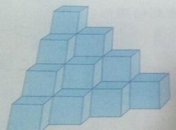

# Mathematics (Grade 1)

**ID**: d9bff36c
**难度**: medium
**题型**: fill_in_the_blank

## 题目
下图是由（    ）个正方体搭成的。

## 解答

**答案**: 20

1. Step1:分析第一层，只有1个正方体
2. Step2:分析第二层，有2 + 1 = 3个正方体
3. Step3:分析第三层，有3 + 2 + 1 = 6个正方体
4. Step4:分析第四层，有4 + 3 + 2 + 1 = 10个正方体
5. Step5:将四层正方体的数量相加，即1 + 3 + 6 + 10 = 20个正方体

## 知识点

**知识点**:
  - --

---
