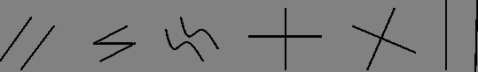

# Mathematics (Grade 1)

**ID**: ea4b20c9
**难度**: medium
**题型**: fill_in_the_blank

## 题目
是平行线的在（  ）里画√。

（____）      （____）     （____）      （____）     （____）      （____）

## 解答

**答案**: √, , , , , √

1. Step1:观察第一个图形，其为两条平行的直线，根据平行线的定义，在对应的括号里填√
2. Step2:观察第二个图形，其不是两条平行的直线，所以对应的括号里不填
3. Step3:观察第三个图形，其不是两条平行的直线，所以对应的括号里不填
4. Step4:观察第四个图形，其不是两条平行的直线，所以对应的括号里不填
5. Step5:观察第五个图形，其不是两条平行的直线，所以对应的括号里不填
6. Step6:观察第六个图形，其为两条平行的直线，根据平行线的定义，在对应的括号里填√

## 知识点

**知识点**:
  - 小学数学;图形与几何;平面图形;平行与垂直的特征、性质

---
