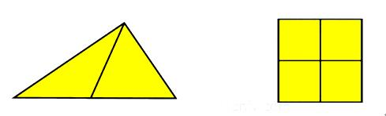

# Mathematics (Grade 1)

**ID**: f7fce38e
**难度**: medium
**题型**: fill_in_the_blank

## 题目

（_____）个三角形              （_____）个正方形

## 解答

**答案**: 3, 5

1. Step1:数三角形，先数小三角形，有2个
2. Step2:2个小三角形组成1个大三角形，所以三角形总数为2 + 1 = 3个
3. Step3:数正方形，先数小正方形，有4个
4. Step4:4个小正方形组成1个大正方形，所以正方形总数为4 + 1 = 5个

## 知识点

**知识点**:
  - 

---
