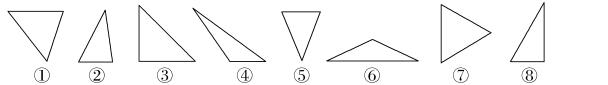

# Mathematics (Grade 1)

**ID**: 17fef92c
**难度**: medium_hard
**题型**: fill_in_the_blank

## 题目
将下列三角形进行分类。（填序号）

锐角三角形（）
直角三角形（）
钝角三角形（）
等腰三角形（）
等边三角形（）

## 解答

**答案**: ①②⑤⑦, ③⑧, ④⑥, ③⑤⑥⑦, ⑦

1. Step1:根据三角形按角分类的定义，三个角都是锐角的三角形为锐角三角形，从图中找出①②⑤⑦符合此特征，所以锐角三角形为①②⑤⑦
2. Step2:根据三角形按角分类的定义，有一个角是直角的三角形为直角三角形，从图中找出③⑧符合此特征，所以直角三角形为③⑧
3. Step3:根据三角形按角分类的定义，有一个角是钝角的三角形为钝角三角形，从图中找出④⑥符合此特征，所以钝角三角形为④⑥
4. Step4:根据三角形按边分类的定义，有两条边相等的三角形为等腰三角形，从图中找出③⑤⑥⑦符合此特征，所以等腰三角形为③⑤⑥⑦
5. Step5:根据三角形按边分类的定义，三条边都相等的三角形为等边三角形，从图中找出⑦符合此特征，所以等边三角形为⑦

## 知识点

**知识点**:
  - 三角形的分类

---
