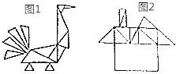

# Mathematics (Grade 1)

**ID**: 2685c4a6
**难度**: medium_hard
**题型**: fill_in_the_blank

## 题目
数一数如图图形中三角形的个数
图1中 $\underline{\hspace{5em}}$ 个三角形
图2中 $\underline{\hspace{5em}}$ 个三角形．

## 解答

**答案**: 15, 15

1. Step1:数图1中单个的三角形个数，得到14个
2. Step2:数图1中由2个三角形组成的三角形个数，得到1个
3. Step3:将图1中单个三角形个数与由2个三角形组成的三角形个数相加，14 + 1 = 15个，得出图1三角形个数
4. Step4:数图2中单个的三角形个数，得到11个
5. Step5:数图2中由2个三角形组成的三角形个数，得到3个
6. Step6:数图2中由5个三角形组成的三角形个数，得到1个
7. Step7:将图2中单个三角形个数、由2个三角形组成的三角形个数、由5个三角形组成的三角形个数相加，11 + 3 + 1 = 15个，得出图2三角形个数

## 知识点

**知识点**:
  - 组合图形的计数

---
