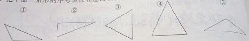

# Mathematics (Grade 1)

**ID**: 380dd436
**难度**: medium_hard
**题型**: fill_in_the_blank

## 题目
把下面三角形的序号填在相应的横线上。

 ①  ②  ③  ④  ⑤
 （1）锐角三角形：______
 （2）直角三角形；______
 （3）钝角三角形：______
 （4）等腰三角形：______
 （5）等边三角形：______

## 解答

**答案**: ③、④, ②, ①、⑤, ④、⑤, ③

1. Step1:明确三个角都是锐角的三角形是锐角三角形，据此判断出③、④是锐角三角形
2. Step2:明确有一个角是直角的三角形是直角三角形，据此判断出②是直角三角形
3. Step3:明确有一个角是钝角的三角形是钝角三角形，据此判断出①、⑤是钝角三角形
4. Step4:明确有两条边相等的三角形是等腰三角形，据此判断出④、⑤是等腰三角形
5. Step5:明确三条边都相等的三角形是等边三角形，据此判断出③是等边三角形

## 知识点

**知识点**:
  - 

---
