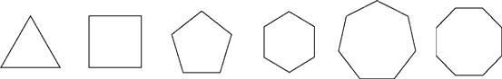

# Mathematics (Grade 1)

**ID**: 3f01fc73
**难度**: medium_hard
**题型**: fill_in_the_blank

## 题目
找出如图所示的每个正多边形的对称轴的条数，并填入表格中。你发现了什么？

$\begin{array}{|c|c|c|c|c|c|c|}
\hline
正多边形的边数
 & 3
 & 4
 & 5
 & 6
 & 7
 & 8
 \\\hline
对称轴的条数
 &  
 &  
 &  
 &  
 &  
 &  
 \\\hline
\end{array}$
我发现：____________________________________________________。

## 解答

**答案**: 3, 4, 5, 6, 7, 8, 正多边形有几条边就有几条对称轴

1. Step1:明确第一个正多边形是正三角形，边数为3，根据正多边形对称轴的性质，其对称轴条数为3
2. Step2:明确第二个正多边形是正方形，边数为4，其对称轴条数为4
3. Step3:明确第三个正多边形是正五边形，边数为5，其对称轴条数为5
4. Step4:明确第四个正多边形是正六边形，边数为6，其对称轴条数为6
5. Step5:明确第五个正多边形是正七边形，边数为7，其对称轴条数为7
6. Step6:明确第六个正多边形是正八边形，边数为8，其对称轴条数为8
7. Step7:通过观察以上结果，总结发现正多边形有几条边就有几条对称轴

## 知识点

**知识点**:
  - 小学数学;探索规律;图形的变化规律

---
