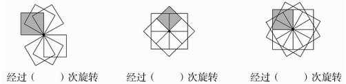

# Mathematics (Grade 1)

**ID**: 4bd9763a
**难度**: medium_hard
**题型**: fill_in_the_blank

## 题目
下面是一个正方形（阴影部分）绕着一个顶点经过多少次旋转后形成的图案？

## 解答

**答案**: 5, 7, 11

1. Step1:观察第一幅图形，确定阴影部分正方形绕顶点旋转，通过计数得出经过5次旋转后形成给定图案
2. Step2:观察第二幅图形，确定阴影部分正方形绕顶点旋转，通过计数得出经过7次旋转后形成给定图案
3. Step3:观察第三幅图形，确定阴影部分正方形绕顶点旋转，通过计数得出经过11次旋转后形成给定图案

## 知识点

**知识点**:
  - 旋转

---
