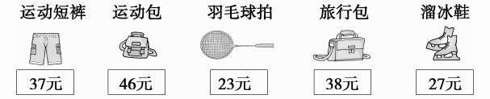

# Mathematics (Grade 1)

**ID**: 50a808ae
**难度**: medium_hard
**题型**: fill_in_the_blank

## 题目
应用题。

（1）小胖买了两个不同款式的包，一共用去多少元？
（2）小亚用100元买了一条运动短裤和一双溜冰鞋，应找回多少元？
（3）小丁丁买了（）和（）两件物品，正好50元。

## 解答

**答案**: 84, 36, 羽毛球拍, 溜冰鞋

1. Step1:根据题目（1），找到运动包价格46元，旅行包价格38元，将两者相加，46 + 38 = 84元，得到一共用去的钱数
2. Step2:对于题目（2），已知付了100元，运动短裤37元，溜冰鞋27元，用100先减去运动短裤的价格100 - 37，再减去溜冰鞋的价格，即(100 - 37) - 27 = 36元，得到应找回的钱数
3. Step3:针对题目（3），查看各物品价格，发现羽毛球拍23元，溜冰鞋27元，23 + 27 = 50元，得出小丁丁买的是羽毛球拍和溜冰鞋

## 知识点

**知识点**:
  - 整数的加法和减法

---
