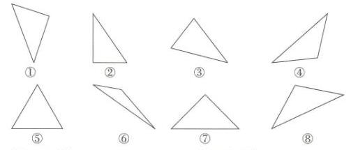

# Mathematics (Grade 1)

**ID**: 513c130b
**难度**: medium_hard
**题型**: fill_in_the_blank

## 题目

 锐角三角形有：____
 直角三角形有：____
 钝角三角形有：____
 等腰三角形有：____
 等边三角形有：____

## 解答

**答案**: ③⑤, ①②⑦, ④⑥⑧, ④⑤⑦⑧, ⑤

1. Step1:根据三角形分类定义，最大角是锐角的三角形是锐角三角形，据此从给定图形中找出③⑤是锐角三角形
2. Step2:最大角是直角的三角形是直角三角形，依此找出①②⑦是直角三角形
3. Step3:最大角是钝角的三角形是钝角三角形，从而确定④⑥⑧是钝角三角形
4. Step4:两条边相等的三角形是等腰三角形，据此得到④⑤⑦⑧是等腰三角形
5. Step5:三条边都相等的三角形是等边三角形，进而找出⑤是等边三角形

## 知识点

**知识点**:
  - 三角形;三角形的特性及分类

---
