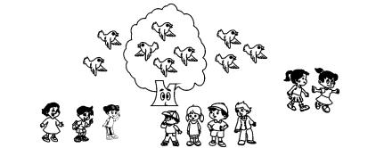

# Mathematics (Grade 1)

**ID**: 60e97210
**难度**: medium_hard
**题型**: fill_in_the_blank

## 题目
看图填一填，算一算。（kàn tú tián yi tián，suàn yi suàn。）

1.现在有多少个小朋友？
□○□○□=□（个）
2.树上还剩几只小鸟？
□○□○□=□（只）

## 解答

**答案**: 7, 6

1. Step1:分析第1题，明确数量关系为用原来的小朋友人数减去走掉的人数，再加上又来的人数，即6 - 2 + 3
2. Step2:计算6 - 2 + 3的结果，先算6 - 2 = 4，再算4 + 3 = 7，得出现在小朋友的数量为7个
3. Step3:分析第2题，明确数量关系为用原来树上小鸟的只数减去飞走的只数，再加上又飞来的只数，即7 - 3 + 2
4. Step4:计算7 - 3 + 2的结果，先算7 - 3 = 4，再算4 + 2 = 6，得出树上还剩小鸟的数量为6只

## 知识点

**知识点**:
  - 10以内数的加减法

---
