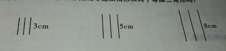

# Mathematics (Grade 1)

**ID**: 673a1a26
**难度**: medium_hard
**题型**: fill_in_the_blank

## 题目
你能用下面9根小棒摆成等边三角形和两个等腰三角形吗？

 3cm  5cm 8cm
 等腰三角形选：(    )、(    )、(    )或(    )、(    )、(    )
 等边三角形选：(    )、(    )、(    )

## 解答

**答案**: 3cm, 3cm, 5cm, 5cm, 5cm, 3cm, 8cm, 8cm, 8cm

1. Step1:明确等腰三角形的定义为至少有两边相等的三角形
2. Step2:根据小棒长度，尝试找出满足等腰三角形条件的组合，得到3cm、3cm、5cm和5cm、5cm、3cm这两组
3. Step3:明确等边三角形的定义为三边都相等的三角形
4. Step4:根据小棒长度，找出满足等边三角形条件的组合为8cm、8cm、8cm
5. Step5:将找到的等腰三角形和等边三角形的小棒组合按顺序整理成列表['3cm', '3cm', '5cm', '5cm', '5cm', '3cm', '8cm', '8cm', '8cm']

## 知识点

**知识点**:
  - 

---
