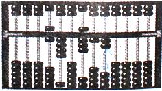

# Mathematics (Grade 1)

**ID**: c7f55092
**难度**: medium_hard
**题型**: fill_in_the_blank

## 题目
算盘是我国最早使用的计算工具，上方每颗珠子代表 $\underline{\hspace{5em}}$ ，下方每颗珠子代表 $\underline{\hspace{5em}}$ ，写出右边算盘上的数 $\underline{\hspace{5em}}$ ．

## 解答

**答案**: 5, 1, 640812

1. Step1:明确算盘的计数规则，上方每颗珠子代表5
2. Step2:明确算盘的计数规则，下方每颗珠子代表1
3. Step3:看算盘的数十万位，上下各有一个珠子，计算得出表示60万
4. Step4:看算盘的万位，下方有4个珠子，计算得出表示4万
5. Step5:看算盘的千位，得出数字是0
6. Step6:看算盘的百位，上面有1个珠子，下面有3个珠子，计算得出表示8百
7. Step7:看算盘的十位，下方有1个珠子，计算得出表示1十
8. Step8:看算盘的个位，下方有2个珠子，计算得出表示2个1
9. Step9:将各个数位上表示的数组合起来，得到数字640812

## 知识点

**知识点**:
  - 整数的认识;计算器与复杂的运算

---
