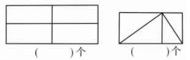

# Mathematics (Grade 1)

**ID**: dcda7963
**难度**: medium_hard
**题型**: fill_in_the_blank

## 题目
下列图形中各有几个长方形

## 解答

**答案**: 9, 3

1. Step1:分析第一个图形，小长方形有4个
2. Step2:计算第一个图形中由2个小长方形组成的较大长方形，有4个
3. Step3:第一个图形整体是1个长方形
4. Step4:计算第一个图形中长方形总数，4 + 4 + 1 = 9个
5. Step5:分析第二个图形，小长方形有2个
6. Step6:第二个图形整体是1个长方形
7. Step7:计算第二个图形中长方形总数，2 + 1 = 3个

## 知识点

**知识点**:
  - 基本图形的计数(奥数);长方形的认识

---
