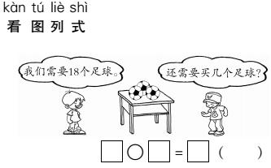

# Mathematics (Grade 1)

**ID**: e795f0e2
**难度**: medium_hard
**题型**: fill_in_the_blank

## 题目

看图列式（kàn  tú  liè  shì）
我们需要18个足球。
还需要买几个足球？
□○□=□（）

## 解答

**答案**: 15

1. Step1:明确题目需求是求还需要买几个足球
2. Step2:从图和题目信息中获取总共需要18个足球
3. Step3:从图中获取已有3个足球
4. Step4:根据减法的意义，用总共需要的足球数减去已有的足球数，即18 - 3
5. Step5:计算18 - 3的结果为15

## 知识点

**知识点**:
  - 看图列式

---
