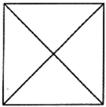

# Mathematics (Grade 1)

**ID**: 07e5240e
**难度**: medium_hard
**题型**: multiple_choice

## 题目
下图是一个正方形，它有（  ）
 

A．四组平行线四组垂线
B．两组平行线四组垂线
C．两组平行线六组垂线
D．两组平行线五组垂线

## 解答

**答案**: D

1. Step1:明确本题考查的是正方形中平行线和垂线的组数，需依据垂直与平行的定义以及正方形的特点来判断
2. Step2:根据正方形的特点，其对边平行，所以有两组平行线
3. Step3:正方形相邻的边互相垂直，有四组邻边，即四组垂线，再加上两条对角线互相垂直，所以共有五组垂线
4. Step4:综上，这个正方形有两组平行线五组垂线，答案选D

## 知识点

**知识点**:
  - 垂直与平行的特征及性质．

---
