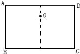

# Mathematics (Grade 1)

**ID**: 13c6f03d
**难度**: medium_hard
**题型**: multiple_choice

## 题目
将长方形ABCD沿着竖中线（如图）对折，在折痕处任取一点O，连接OB、OC所形成的△OBC一定是（  ）三角形．
A．等腰三角形
B．等边三角形
C．直角三角形

## 解答

**答案**: A

1. Step1:明确长方形沿着竖中线对折，折痕处任取一点O，O点所在直线为对称轴
2. Step2:根据对称轴的性质，可知对称轴上的点到对称点的距离相等，所以O到B和C的距离相等
3. Step3:根据等腰三角形的定义，有两条边相等的三角形是等腰三角形，因为OB = OC，所以△OBC一定是等腰三角形

## 知识点

**知识点**:
  - 简单图形的折叠问题．

---
