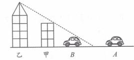

# Mathematics (Grade 1)

**ID**: 1db5d15b
**难度**: medium_hard
**题型**: multiple_choice

## 题目
林叔叔驾驶小汽车在公路上行驶，前方有两座建筑物，下面说法正确的是（）

A.小汽车行驶到A时，林叔叔能看到建筑物乙
B.小汽车行驶到B时，林叔叔能看到建筑物乙
C.小汽车行驶到A和B时，林叔叔都能看到建筑物甲

## 解答

**答案**: A

1. Step1:分析小汽车在A点的情况，可知在A点时驾驶者向前望去能看见建筑物甲和乙，只是甲把乙挡住了一部分
2. Step2:分析小汽车在B点的情况，可知在B点时建筑乙处在小汽车的盲区，看不到建筑乙
3. Step3:分析选项A，小汽车行驶到A时能看到建筑物乙，该选项说法正确
4. Step4:分析选项B，小汽车行驶到B时看不到建筑物乙，该选项说法错误
5. Step5:分析选项C，小汽车行驶到B时看不到建筑物乙，但能看到建筑物甲，小汽车行驶到A时能看到建筑物甲和乙，所以该选项说法错误
6. Step6:综上，正确答案是A

## 知识点

**知识点**:
  - 从不同位置观察立体图形

---
