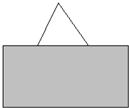

# Mathematics (Grade 1)

**ID**: 20c3ef31
**难度**: medium_hard
**题型**: multiple_choice

## 题目
一个三角形的下部被一张纸遮住了（如图），只露出了一个角，这个三角形是（  ）三角形．
A．钝角
B．锐角
C．直角
D．无法确定

## 解答

**答案**: D

1. Step1:明确三角形按角分类有锐角三角形、直角三角形、钝角三角形三种，依据是解析2
2. Step2:分析题目条件，仅露出一个锐角，对于被遮住的两个角情况未知，可能都是锐角，也可能有一个钝角，还可能有一个直角
3. Step3:根据上述分析，这个三角形可能是锐角三角形，可能是直角三角形，也可能是钝角三角形，所以无法确定，答案选D

## 知识点

**知识点**:
  - 三角形的分类．

---
