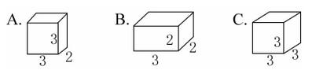

# Mathematics (Grade 1)

**ID**: 2dd5980d
**难度**: medium_hard
**题型**: multiple_choice

## 题目
下列图形中，（）是正方体。

## 解答

**答案**: C

1. Step1:明确正方体的定义，正方体是特殊的长方体，有6个面、8个顶点、12条棱，其6个面均全等，12条棱均相等
2. Step2:分析选项A，其中图形的长与高相等，与宽不相等，不满足正方体12条棱均相等的条件，不是正方体
3. Step3:分析选项B，其中图形的宽与高相等，与长不相等，不满足正方体12条棱均相等的条件，不是正方体
4. Step4:分析选项C，其中图形的长、宽、高均相等，满足正方体12条棱均相等的条件，是正方体
5. Step5:综上，答案是C

## 知识点

**知识点**:
  - 长方体正方体的认识

---
