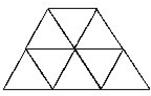

# Mathematics (Grade 1)

**ID**: 3025526d
**难度**: medium_hard
**题型**: multiple_choice

## 题目
如图中一共有（  ）个三角形．
A．8
B．9
C．10

## 解答

**答案**: C

1. Step1:观察图形，确定先数小三角形的数量，数出小三角形共8个
2. Step2:接着找由4个小三角形组成的大三角形，数出有2个
3. Step3:将小三角形的数量和4个小三角形组成的大三角形的数量相加，即8 + 2 = 10个
4. Step4:根据选项，选择答案为C

## 知识点

**知识点**:
  - 组合图形的计数．

---
