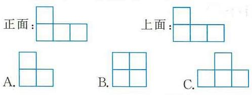

# Mathematics (Grade 1)

**ID**: 39a84e9f
**难度**: medium_hard
**题型**: multiple_choice

## 题目
小明用6个同样的正方体搭成了一个立体图形．下面分别是从正面、上面看到的形状，从左面看到的形状不可能是图（  ）．

## 解答

**答案**: C

1. Step1:根据正面看到的形状，可知立体图形最左边上下各有1个正方体，中间和右边各有1个正方体
2. Step2:依据上面看到的形状，可知立体图形最左边有2排，上下各2个正方体
3. Step3:结合前面两步分析，判断选项A和B的形状是可能的
4. Step4:得出选项C的形状不可能，所以从左面看到的形状不可能是图C

## 知识点

**知识点**:
  - 期末检测
--

---
