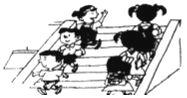

# Mathematics (Grade 1)

**ID**: 405a1cc7
**难度**: medium_hard
**题型**: multiple_choice

## 题目
上楼的小朋友是靠（    ）边走。

A．左
B．右
C．前
D．后

## 解答

**答案**: B

1. Step1:明确题目是判断上楼小朋友靠哪边走
2. Step2:依据左右关系的相对性，考虑上楼小朋友与下楼小朋友的位置关系
3. Step3:得出上楼小朋友面向前方相对于下楼小朋友位于右侧，即靠右边走
4. Step4:确定答案为选项B

## 知识点

**知识点**:
  - 

---
