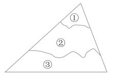

# Mathematics (Grade 1)

**ID**: 48f3f542
**难度**: medium_hard
**题型**: multiple_choice

## 题目
一块三角形玻璃不小心摔碎成如图所示的三片。只需带着其中的一片，玻璃店的师傅就能重新配一块与原来相同的玻璃，则应该带编号为（）的玻璃。

## 解答

**答案**: ③

1. Step1:明确目标是配一块与原来相同的玻璃，即两个三角形完全重合。
2. Step2:分析①号玻璃，其只有一个角与原三角形重合，角的两边可无限延伸，不能得到与原三角形重合的三角形。
3. Step3:分析②号玻璃，其有两条边与原三角形重合，两边延伸只能确定一个角，无法得到与原三角形重合的三角形。
4. Step4:分析③号玻璃，其有两个角和一边与原三角形完全重合，角的另外两边延伸后可交于一点，能得到与原三角形重合的三角形。
5. Step5:综上，应该带编号为③的玻璃。

## 知识点

**知识点**:
  - 三角形的认识

---
