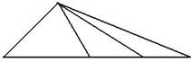

# Mathematics (Grade 1)

**ID**: 4e663a1c
**难度**: medium_hard
**题型**: multiple_choice

## 题目
                       
在图中有（  ）个钝角三角形．
A．3
B．4
C．5

## 解答

**答案**: B

1. Step1:明确钝角三角形的定义为有一个角是钝角的三角形
2. Step2:观察给定的图形
3. Step3:按照钝角三角形的定义去数图中钝角三角形的个数
4. Step4:得出图中有4个钝角三角形
5. Step5:根据选项，选择答案B

## 知识点

**知识点**:
  - 三角形的分类．

---
