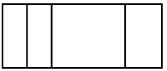

# Mathematics (Grade 1)

**ID**: 5367e99b
**难度**: medium_hard
**题型**: multiple_choice

## 题目
如图，图中共有（  ）个长方形．
$\begin{description}
\item A．8\item B．9\item C．10
\end{description}$

## 解答

**答案**: C

1. Step1:确定从底边左边第一个点出发，数出长方形的个数为4个
2. Step2:确定从底边左边第二个点出发，数出长方形的个数为3个
3. Step3:确定从底边左边第三个点出发，数出长方形的个数为2个
4. Step4:确定从底边左边第四个点出发，数出长方形的个数为1个
5. Step5:将从不同点出发数出的长方形个数相加，即4 + 3 + 2 + 1 = 10个
6. Step6:根据选项，答案为C

## 知识点

**知识点**:
  - 组合图形的计数．

---
