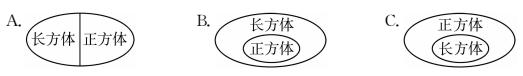

# Mathematics (Grade 1)

**ID**: 79e0dcc7
**难度**: medium_hard
**题型**: multiple_choice

## 题目
长方体与正方体的关系，下面图中表示正确的是（）。

## 解答

**答案**: B

1. Step1:明确本题考查正方体和长方体的关系，需要依据相关定义判断选项。
2. Step2:根据对长方体和正方体的认识，思考当长方体的长、宽、高相等时的情况，可知此时它是正方体，且它仍然属于长方体。
3. Step3:得出正方体是特殊的长方体，即长方体包含正方体这一结论。
4. Step4:观察选项，A选项是并列关系，C选项包含关系错误，只有B选项表示长方体包含正方体，符合结论。
5. Step5:确定答案为B。

## 知识点

**知识点**:
  - 长方体正方体的认识

---
