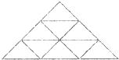

# Mathematics (Grade 1)

**ID**: 8150c7e6
**难度**: medium_hard
**题型**: multiple_choice

## 题目
如图中，有(  )个三角形．

A．11
B．12
C．13

## 解答

**答案**: C

1. Step1:计算尖朝上的基本三角形数量，1+2+3=6个
2. Step2:计算尖朝上的边长为二的三角形数量，1+2=3个
3. Step3:计算尖朝上的边长为三的三角形数量，为1个
4. Step4:计算尖朝下的基本三角形数量，1+2=3个
5. Step5:将尖朝上的基本三角形、边长为二的三角形、边长为三的三角形以及尖朝下的基本三角形数量相加，6+3+1+3=13个

## 知识点

**知识点**:
  - 组合图形的计数．

---
