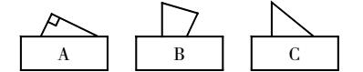

# Mathematics (Grade 1)

**ID**: b3a25ea6
**难度**: medium_hard
**题型**: multiple_choice

## 题目
下面的三角形都被纸片遮住了一部分，不能肯定是什么三角形的是（）。

## 解答

**答案**: C

1. Step1:明确三角形按角可分为锐角三角形、直角三角形、钝角三角形
2. Step2:观察A，发现其中有一个角是直角，所以A是直角三角形
3. Step3:观察B，发现其三个内角都是锐角，所以B是锐角三角形
4. Step4:观察C，无法确定其三角形的内角度数，所以不能肯定C是什么三角形
5. Step5:得出不能肯定是什么三角形的是C

## 知识点

**知识点**:
  - 三角形的分类

---
