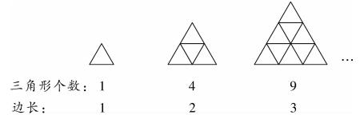

# Mathematics (Grade 1)

**ID**: df68eaaa
**难度**: medium_hard
**题型**: multiple_choice

## 题目
如图，按照下边的排列规律，当边长是10时，三角形的个数是（）
A.10
B.20
C.30
D.100

## 解答

**答案**: D

1. Step1:观察发现，当边长=1时，三角形的个数=1=1²
2. Step2:当边长=2时，三角形的个数=4=2²
3. Step3:当边长=3时，三角形的个数=9=3²
4. Step4:总结规律，得出三角形的个数=(边长)²
5. Step5:已知边长为10，将其代入规律式，可得三角形个数为10²
6. Step6:计算10²=100，所以答案为100，对应选项D

## 知识点

**知识点**:
  - 图形中的规律

---
