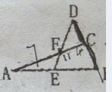

# Mathematics (Grade 1)

**ID**: e5eaddbd
**难度**: medium_hard
**题型**: multiple_choice

## 题目
10．如图，已知E是AB的中点，AF＝BD＝7，AC＝11，则DC的长是 （    ）
 A 、7
 B、 6
 C、 5
 D、 4

## 解答

**答案**: D

1. Step1:延长EF至G，使EF=GE，连接BG，因为E是AB中点，所以AE=BE
2. Step2:在△AFE与△BGE中，由于AE=BE，∠AEF=∠BEG（对顶角相等），FE=GE，根据全等三角形判定（SAS），得出△AFE≌△BGE
3. Step3:由△AFE≌△BGE，可得GB=AF，∠G=∠AFG=∠DFC
4. Step4:已知AF=BD=7，所以GB=BD=7
5. Step5:因为GB=BD，所以∠D=∠G，又因为∠G=∠AFG=∠DFC，所以∠D=∠DFC
6. Step6:由∠D=∠DFC，根据等角对等边，得出CD=CF
7. Step7:已知AC=11，AF=7，因为CF=AC - AF，所以CF=11 - 7 = 4
8. Step8:因为CD=CF，所以DC=4，答案选D

## 知识点

**知识点**:
  - 

---
