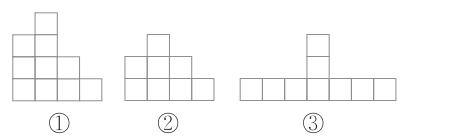

# Mathematics (Grade 1)

**ID**: e9844b66
**难度**: medium_hard
**题型**: multiple_choice

## 题目
下面的图形能通过平移小正方形得到一个大正方形的是（）。（xià miàn de tú xíng néng tōng guò píng yí xiǎo zhèng fāng xíng dé dào yí gè dà zhèng fāng xíng de shì（））

## 解答

**答案**: ③

1. Step1:明确正方形的特点为四个边都相等
2. Step2:对图形①进行平移尝试，判断是否能得到四个边都相等的图形，发现不能
3. Step3:对图形②进行平移尝试，判断是否能得到四个边都相等的图形，发现不能
4. Step4:对图形③进行平移尝试，判断是否能得到四个边都相等的图形，发现可以
5. Step5:得出能通过平移小正方形得到一个大正方形的是图形③

## 知识点

**知识点**:
  - 平移;正方形的认识

---
