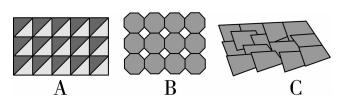

# Mathematics (Grade 1)

**ID**: f01ef434
**难度**: medium_hard
**题型**: multiple_choice

## 题目
选一选。（将正确答案的序号填入括号里）
下面是由同一种平面图形密铺的是（）。

## 解答

**答案**: A

1. Step1:明确密铺的定义，即要用形状、大小完全相同的几种或几十种平面图形进行拼接，彼此之间不留空隙、不重叠地铺成一片
2. Step2:分析B选项，发现其图形中有空隙，不满足密铺定义中不留空隙的要素
3. Step3:分析C选项，看到所用的图形形状不一，不满足密铺定义中图形形状大小完全相同的要素
4. Step4:分析A选项，其图形符合密铺定义中形状、大小完全相同且不留空隙的条件

## 知识点

**知识点**:
  - 密铺

---
