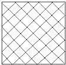

# Mathematics (Grade 1)

**ID**: f793a9de
**难度**: medium_hard
**题型**: multiple_choice

## 题目
如图由相同的正方形和相同的等腰直角三角形构成，则正方形的个数为(  )
A．83
B．79
C．72
D．65

## 解答

**答案**: A

1. Step1:计算边长为1的正方形个数，2+4+6+8+8+6+4+2=40
2. Step2:计算边长为2的正方形个数，1+3+5+7+5+3+1=25
3. Step3:计算边长为3的正方形个数，2+4+4+2=12
4. Step4:计算边长为4的正方形个数，1+3+1=5
5. Step5:加上大正方形1个
6. Step6:计算正方形总个数，40+25+12+5+1=83
7. Step7:从选项中找到对应答案，确定选A

## 知识点

**知识点**:
  - 组合图形的计数．

---
