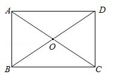

# Mathematics (Grade 1)

**ID**: fc1bb8e2
**难度**: medium_hard
**题型**: multiple_choice

## 题目
如图，长方形ABCD的两条对角线相交于点O。绕点O顺时针或逆时针旋转长方形（）度与原图形重合。

A.90
B.180
C.270
D.360

## 解答

**答案**: B

1. Step1:明确本题是关于长方形绕点O旋转与原图形重合角度的问题
2. Step2:知道可通过实际操作取一张长方形纸片，找出点O进行旋转来求解
3. Step3:得出绕点O顺时针或逆时针旋转长方形180度可与原图形重合
4. Step4:根据选项，确定答案为B

## 知识点

**知识点**:
  - 图形的旋转

---
