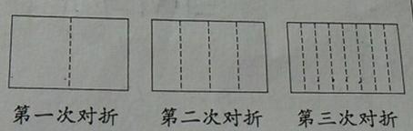

# Mathematics (Grade 1)

**ID**: 06c1ab44
**难度**: medium_hard
**题型**: short_answer

## 题目
将一张长方形的纸对折一次，如下图可得到1条折痕（图中虚线）；继续对折，对折时每次折痕与上次的折痕保持平行。对折两次可得到3条折痕，连续对折三次后，可以得到7条折痕。

 第一次对折    第二次对折    第三次对折
 照这样对折五次可以得到多少条折痕？对折八次呢？

## 解答

**答案**: 31, 255

1. Step1:分析对折次数与折痕数的关系，发现第一次对折折痕数为1=2**1 - 1
2. Step2:发现第二次对折折痕数为3=2**2 - 1
3. Step3:发现第三次对折折痕数为7=2**3 - 1
4. Step4:总结规律，得出第n次对折折痕数为(2**n - 1)条
5. Step5:当n = 5时，计算2**5 - 1 = 32 - 1 = 31
6. Step6:当n = 8时，计算2**8 - 1 = 256 - 1 = 255

## 知识点

**知识点**:
  - 

---
