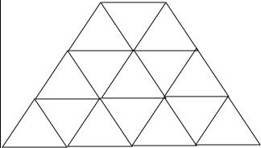

# Mathematics (Grade 1)

**ID**: 705bece8
**难度**: medium_hard
**题型**: short_answer

## 题目
数一数图中共有多少个三角形？

## 解答

**答案**: 23

1. Step1:先数由1个小三角形构成的小三角形个数，最上层有3个，中间层有7个，最下层有5个，所以小三角形总数为3 + 7 + 5 = 15个
2. Step2:再数由4个小三角形组成的大三角形个数，上层有4个，整体还有1个，共4 + 1 = 6个
3. Step3:接着数由9个小三角形组成的大三角形个数，有2个
4. Step4:最后将上述三种三角形的个数相加，15 + 6 + 2 = 23个

## 知识点

**知识点**:
  - 组合图形的计数

---
