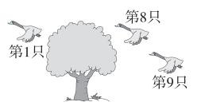

# Mathematics (Grade 1)

**ID**: 92218c8b
**难度**: medium_hard
**题型**: short_answer

## 题目
大树遮住了几只大雁？分别遮住的是哪几只？（dà shù zhē le jǐ zhī dà yàn？fēn bié zhē zhù de shì nǎ jǐ zhī？）

## 解答

**答案**: 6, 第2只, 第3只, 第4只, 第5只, 第6只, 第7只

1. Step1:明确数序排位从左到右分别是第1只，第2只，第3只，第4只，第5只，第6只，第7只，第8只，第9只
2. Step2:观察发现树在第1只大雁和第8只大雁之间
3. Step3:确定树后面应该是从第2只到第7只大雁
4. Step4:数出被大树遮住的大雁数量为6只
5. Step5:得出被遮住的大雁分别是第2只，第3只，第4只，第5只，第6只，第7只

## 知识点

**知识点**:
  - 10以内数的认识;位置与顺序

---
