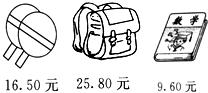

# Mathematics (Grade 1)

**ID**: b6f7a316
**难度**: medium_hard
**题型**: short_answer

## 题目

（1）买这三件物品一共需要多少钱？
（2）孙勇买一副乒乓球拍和一本书，付了50元，应找回多少钱？

## 解答

**答案**: 51.90, 23.90

1. Step1:计算买三件物品的总价，将乒乓球拍单价16.50元、书包单价25.80元、书单价9.60元相加，即16.50+25.80+9.60=51.90元，得出买这三件物品一共需要51.90元
2. Step2:计算买一副乒乓球拍和一本书的总价，将乒乓球拍单价16.50元和书单价9.60元相加，即16.50+9.60=26.10元
3. Step3:计算付50元买一副乒乓球拍和一本书应找回的钱数，用50元减去买一副乒乓球拍和一本书的总价26.10元，即50 - 26.10=23.90元

## 知识点

**知识点**:
  - 整数、小数复合应用题．

---
