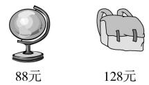

# Mathematics (Grade 1)

**ID**: e9dff598
**难度**: medium_hard
**题型**: short_answer

## 题目
妈妈给小明买一个地球仪和一个书包，她付给售货员300元， 应该找回多少元？

## 解答

**答案**: 84

1. Step1:明确要得到找回的钱数，需先算出买东西用去的钱数
2. Step2:根据已知，将地球仪的价格88元和书包的价格128元相加，即88 + 128 = 216元，得到买东西用去的钱数
3. Step3:用付给售货员的300元减去买东西用去的216元，即300 - 216 = 84元，得到应找回的钱数

## 知识点

**知识点**:
  - 整数的加法和减法;整数复合应用题

---
