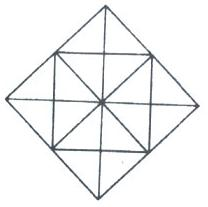

# Mathematics (Grade 1)

**ID**: f95a7717
**难度**: medium_hard
**题型**: short_answer

## 题目
观察下面的图，数一数，图中有多少个三角形？

## 解答

**答案**: 44

1. Step1:数出图中单个的三角形数量，得到16个
2. Step2:数出图中2个组合的三角形数量，得到16个
3. Step3:数出图中4个组合的三角形数量，得到8个
4. Step4:数出图中8个组合的三角形数量，得到4个
5. Step5:将单个、2个组合、4个组合、8个组合的三角形数量相加，即16+16+8+4，得出总数为44个

## 知识点

**知识点**:
  - 组合图形的计数

---
