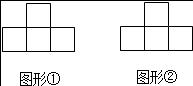

# Mathematics (Grade 1)

**ID**: 01439169
**难度**: medium
**题型**: multiple_choice

## 题目
一个用小正方体搭成的立体图形，从前面看到的是图形①（如图），从上面看到的是图形②（如图），那么搭成这样一个立体图形最少要（  ）个小正方体．
A．4
B．5
C．6
D．7

## 解答

**答案**: B

1. Step1:根据从前面看到的图形，分析得出至少需要4个小正方体，即下面三个，上边一个
2. Step2:根据从上面看到的图形，分析得出至少需要4个小正方体，即前排3个，后排在中间有1个
3. Step3:找出两种视图分析结果中的公共部分，确定为3个
4. Step4:计算最少需要的小正方体个数，为3 + 1 + 1 = 5个

## 知识点

**知识点**:
  - 图形的拼组．

---
