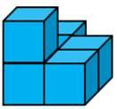

# Mathematics (Grade 1)

**ID**: 0fa15939
**难度**: medium
**题型**: multiple_choice

## 题目
数一数，图中至少由_______个小正方体组成．

A．5
B．6
C．7

## 解答

**答案**: B

1. Step1:观察图形，从最上层开始数，最上层有1个小正方体
2. Step2:再看底层，底层前排有2个小正方体
3. Step3:底层后排有3个小正方体
4. Step4:将各层小正方体数量相加，1 + 2 + 3 = 6个
5. Step5:得出图中至少由6个小正方体组成，答案选B

## 知识点

**知识点**:
  - 小学数学;数与代数;数的认识;整数的认识

---
