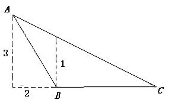

# Mathematics (Grade 1)

**ID**: 18b617d1
**难度**: medium
**题型**: multiple_choice

## 题目
如图，属于钝角三角形ABC的高的是（  ）

$\begin{description}
\item A．1\item B．2\item C．3
\end{description}$

## 解答

**答案**: C

1. Step1:明确三角形高的定义为三角形的顶点到对边的垂线段的长度
2. Step2:观察图形，此三角形为钝角三角形，其两条高在底边的延长线上
3. Step3:根据图形可知3是从顶点A向对边BC所在直线作的垂线段，符合三角形高的定义
4. Step4:得出属于钝角三角形ABC的高的是3，答案选C

## 知识点

**知识点**:
  - 

---
