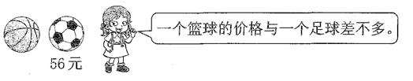

# Mathematics (Grade 1)

**ID**: 3a5f4cb7
**难度**: medium
**题型**: multiple_choice

## 题目

一个篮球的价格可能是（  ）。
A．25元
B．80元
C．55元

## 解答

**答案**: C

1. Step1:题目中表明一个篮球的价格与一个足球差不多，足球价格是56元。
2. Step2:分析选项A，25元与56元相差较大。
3. Step3:分析选项B，80元与56元相差也较大。
4. Step4:分析选项C，55元与56元最为接近，符合差不多的描述。
5. Step5:所以一个篮球的价格可能是55元，答案选C。

## 知识点

**知识点**:
  - 小学数学;数与代数;应用题;常见的数学问题;图文问题

---
