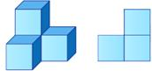

# Mathematics (Grade 1)

**ID**: 3e3cca9d
**难度**: medium
**题型**: multiple_choice

## 题目
淘气做出来一个下图中的模型，从它的（   ）面能够看到右边的图案．

A．上
B．右
C．前

## 解答

**答案**: B

1. Step1:观察模型和右边图案，确定从上面看，模型的形状与右边图案不同，排除选项A
2. Step2:从右边看模型，其形状与右边图案一致，符合要求
3. Step3:从前面看模型，形状与右边图案不同，排除选项C
4. Step4:综上，答案是B

## 知识点

**知识点**:
  - 小学数学;图形与几何;立体图形;观察物体

---
