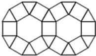

# Mathematics (Grade 1)

**ID**: 460c5caf
**难度**: medium
**题型**: multiple_choice

## 题目
图案中，除了有正三角形、正方形外，还可以找到（ ）

$\begin{description}
\item A．正五边形\item B．正八边形\item C．正十二边形
\end{description}$

## 解答

**答案**: C

1. Step1:观察给定图案
2. Step2:分析图案中已有的图形为正三角形和正方形
3. Step3:查看选项，分析A选项正五边形，发现图案中没有正五边形
4. Step4:查看选项，分析B选项正八边形，发现图案中没有正八边形
5. Step5:查看选项，分析C选项正十二边形，发现图案中存在正十二边形
6. Step6:得出答案为C

## 知识点

**知识点**:
  - 

---
