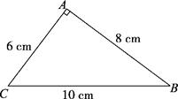

# Mathematics (Grade 1)

**ID**: 4ad2572c
**难度**: medium
**题型**: multiple_choice

## 题目
如下图，B点到直线AC的距离是(  )。

A．6 cm
B．8 cm
C．10 cm

## 解答

**答案**: B

1. Step1:根据点到直线的距离定义，从直线外一点到这条直线所作的垂线段最短，在直角三角形ABC中，∠A是直角，AC和AB互相垂直。
2. Step2:B点到直线AC的垂线段就是AB。
3. Step3:已知AB的长度是8cm，所以B点到直线AC的距离是8cm，答案选B。

## 知识点

**知识点**:
  - 

---
