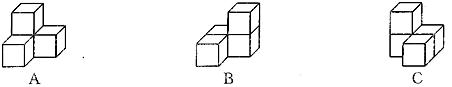

# Mathematics (Grade 1)

**ID**: 735e96da
**难度**: medium
**题型**: multiple_choice

## 题目
从上面看到的形状是一样的是（  ）。

$\begin{description}
\item A．A和B\item B．A和C\item C．B和C
\end{description}$

## 解答

**答案**: A

1. Step1:观察选项A，A选项是A和B，需要分别观察图形A和图形B从上面看到的形状；
2. Step2:观察图形A，从上面看能看到3个正方形，呈“L”形分布；
3. Step3:观察图形B，从上面看能看到3个正方形，呈一排分布；
4. Step4:观察选项B，B选项是A和C，观察图形C从上面看到的形状；
5. Step5:观察图形C，从上面看能看到3个正方形，呈“L”形分布，与图形A从上面看到的形状一样；
6. Step6:观察选项C，C选项是B和C，前面已得出B和C从上面看到的形状不一样；
7. Step7:综上，从上面看到的形状一样的是A和C，答案选B

## 知识点

**知识点**:
  - 

---
