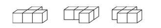

# Mathematics (Grade 1)

**ID**: 7e272fb0
**难度**: medium
**题型**: multiple_choice

## 题目
从( )面看下面三个物体的形状是完全相同的．

A．上面和右面
B．上面和正面
C．正面和右面

## 解答

**答案**: C

1. Step1:观察从上面看这三个物体，形状并不完全相同
2. Step2:观察从正面看这三个物体，形状完全相同
3. Step3:观察从右面看这三个物体，形状完全相同
4. Step4:根据观察结果，正面和右面看到的形状完全相同，符合题目要求，所以答案是C

## 知识点

**知识点**:
  - 小学数学;图形与几何;立体图形;观察物体

---
